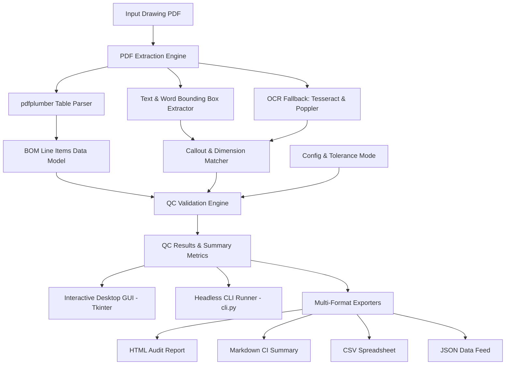

# QC Checking Inventor App (PDF Drawing Checker)

[](https://github.com/MelvinjoseC/Qc-checking-inventor-app/actions/workflows/python-tests.yml)
[](https://www.python.org/)
[](LICENSE)

An enterprise-grade Python application and quality assurance engine designed to audit engineering and fabrication drawing PDFs. It extracts Bill of Materials (BOM) tables (POS, Description, Length, Thickness, and Quantity) and automatically cross-checks drawing sheets to verify that every BOM item possesses a valid graphical callout and matching dimensions.

---

## Architecture Overview



---

## Features

- **Automated BOM Parsing**: Extracts structured table rows from fabrication drawings (`pdfplumber` and heuristic parsing).
- **Multi-Format Callout Matching**: Detects diverse CAD annotation styles (`POS 1`, `POS-1`, `P1`, `#1`, `ITEM 1`, `MK 1`).
- **Flexible Tolerance Modes**: Supports absolute tolerances (e.g., `±0.5 mm`) and percentage-based tolerances (e.g., `±2%`).
- **Dimensional & Unit Conversions**: Seamlessly parses and converts metric (`mm`, `cm`, `m`) and imperial fractional dimensions (`1/2"`, `2-1/2"`, `3/4 in`).
- **Headless CLI (`cli.py`)**: Full command-line interface for pipeline automation, strict exit codes, and automated CI/CD runs.
- **Batch Processing (`batch_processor.py`)**: Concurrent multithreaded processing across entire drawing directories with consolidated markdown reporting.
- **System Diagnostics (`diagnostics.py`)**: Environment health checker validating Python dependencies and external OCR binaries.
- **Multi-Format Reporting**: Export audit results to responsive HTML reports, GitHub-flavored Markdown, CSV spreadsheets, and structured JSON.
- **Desktop Application (`app.py`)**: Modern Tkinter interface with real-time pass/fail highlighting, recent files history, spelling checks, and diagnostics.
- **Structured Logging**: Rotating file logging (`qc_audit.log`) for complete audit traceability.

---

## Installation & Setup

### 1. Python Dependencies

Clone the repository and install runtime dependencies:
```bash
git clone https://github.com/MelvinjoseC/Qc-checking-inventor-app.git
cd Qc-checking-inventor-app
pip install -r requirements.txt
```

For development and test tooling:
```bash
pip install -r requirements-dev.txt
```

### 2. OCR Dependencies (Optional for Scanned Drawings)

For vector PDFs generated directly by CAD tools (Inventor, AutoCAD, SolidWorks), no external OCR binaries are required. For scanned paper drawings:
- **Tesseract OCR**: Install [Tesseract OCR](https://github.com/tesseract-ocr/tesseract) and add to system `PATH`.
- **Poppler Utilities**: Download Poppler binaries and configure `poppler_path` in `config.json` or add to `PATH`.

Run diagnostics at any time to verify system readiness:
```bash
python diagnostics.py
```

---

## Usage

### Desktop GUI Mode

Launch the interactive quality control desktop interface:
```bash
python app.py
```
- Click **Upload PDF and Check** to select a drawing.
- Inspect row-by-row pass/fail status and dimensional cross-checks.
- Export results via **Export Results** as HTML, Markdown, CSV, or JSON.
- Check environment readiness under **Help -> System Diagnostics**.

---

### Command-Line Interface (CLI Mode)

Run checks directly in the terminal or CI/CD pipelines without launching the GUI:

```bash
# Print summary to console
python cli.py path/to/drawing.pdf

# Export responsive HTML audit report
python cli.py path/to/drawing.pdf --format html --output report.html

# Export Markdown summary for GitHub pull request comment
python cli.py path/to/drawing.pdf --format markdown --output summary.md

# Pipeline strict mode (exits with code 1 on failure)
python cli.py path/to/drawing.pdf --tolerance 0.25 --strict
```

#### CLI Options
| Flag | Description | Default |
| :--- | :--- | :--- |
| `pdf_path` | Path to drawing PDF file | Required |
| `--config`, `-c` | Path to configuration JSON | `config.json` |
| `--tolerance`, `-t` | Measurement tolerance in mm | From config (`0.5`) |
| `--format`, `-f` | Output format: `summary`, `csv`, `json`, `html`, `markdown` | `summary` |
| `--output`, `-o` | File path to write results to | stdout |
| `--strict` | Exit with code 1 if any BOM item fails | Disabled |
| `--verbose`, `-v` | Enable DEBUG level logging | Disabled |

---

### Batch Directory Processing

Process directories containing multiple drawings concurrently:
```python
from batch_processor import BatchProcessor

processor = BatchProcessor(tolerance=0.5, max_workers=4)
pdf_files = processor.discover_pdfs("path/to/drawings/", recursive=True)
batch_report = processor.process_batch(pdf_files)

# Generate Markdown summary table
md_report = processor.generate_consolidated_markdown(batch_report)
print(md_report)
```

---

## Testing & Quality Assurance

Run the comprehensive unit test suite:
```bash
python -m unittest discover -v -p "test_*.py"
```

The test suite covers:
- Core regex token parsing and normalization (`test_qc_logic.py`)
- Dimension and unit conversion logic (`test_qc_logic.py`)
- Domain dataclasses and serialization (`test_qc_logic.py`)
- HTML, Markdown, CSV, and JSON exporters (`test_qc_logic.py`)
- CLI arguments and exit code workflows (`test_cli.py`)
- Concurrent batch processor aggregation (`test_batch_processor.py`)
- System environment health diagnostics (`test_diagnostics.py`)

---

## Configuration (`config.json`)

```json
{
    "tolerance": 0.5,
    "default_dpi": 300,
    "poppler_path": "",
    "tesseract_path": ""
}
```

---

## Contributing

1. Create a feature branch: `git checkout -b feature/your-feature-name`
2. Implement your changes adhering to PEP 8 standards.
3. Add corresponding unit tests in `test_*.py`.
4. Ensure all unit tests pass: `python -m unittest discover -p "test_*.py"`.
5. Submit a Pull Request targeting the `main` branch.